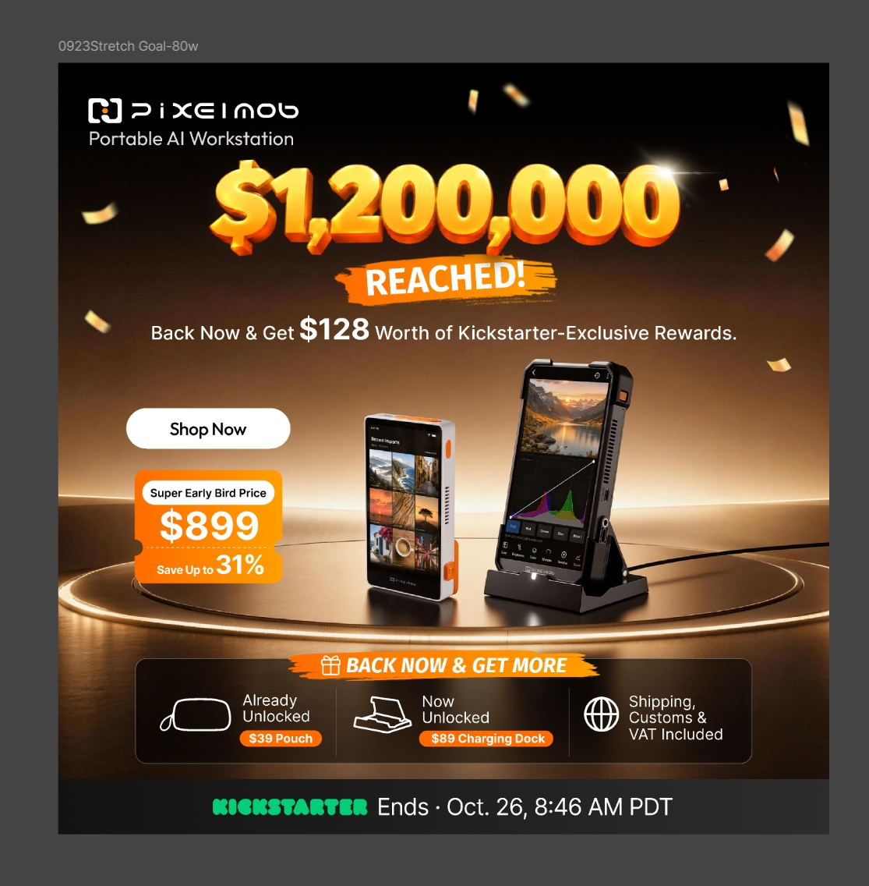

# PixelMob 众筹广告全周期复盘

覆盖前测、预热、上线至众筹结束

这次投放找到了专业摄影与备份需求、真实工作流素材和高意向用户召回等有效组合。首发后新客购买偏弱，结账与选型预算增加时，订单没有同步增长；末期通过实测、权益和有效购买组扩量，效率得到改善。

## 广告分工与用户路径

本项目主要使用Meta的Facebook、Instagram及Google/YouTube。下面区分广告希望用户完成什么动作、投给谁，以及用户点击后去哪里。

|广告任务|后台目标与用户路径|本项目主要投给谁|用什么内容、看什么结果|
|---|---|---|---|
|邮箱留资|Leads / Subscribe：广告→邮箱页→留下邮箱→调研、邮件或社群触达|专业摄影、备份、户外与创作者硬件兴趣用户|备份、整理、工作流等价值介绍；看邮箱数量、成本及后续定金|
|定金购买|Sales / Purchase：广告→独立站定金页→支付10美元定金|前测兴趣组、后续专业场景组、部分相似与再营销人群|明确用途、版本与定金权益；看定金订单、CPA和扩量后成本|
|众筹购买|Sales / Purchase：广告→Kickstarter众筹页或对应认捐档位→提交支持订单|预热定金用户、官网/众筹页访客，也测试兴趣与智能拓量用户|首发优惠、真实工作流、红人实测、限时权益；看归因订单、销售、CPA和ROAS。此时订单是认捐，结束后统一扣款|
|发起结账|Sales / Checkout：广告→众筹页→进入支持/结账流程|以内容创作者、活动摄影等新增兴趣用户为主|用工作流与红人视频吸引进入购买流程；看发起结账成本及后续购买|
|选型问卷|以完成选型结果为主要优化事件：广告→官网选型页→推荐Standard或Pro→跳对应众筹档位|先用浏览、视频观看与互动人群，后期拓展非美国组合|解释卡型、备份和工作需求；看完成选型、进入众筹、发起结账与订单|
|添加支付信息测试|Sales / Add Payment Info：广告→众筹页→添加支付资料|首发后计划以智能拓量及专业兴趣人群测试|尝试在发起结账与购买之间寻找转化机会；实际消耗$123.11，无事件和订单，关闭|
|红人内容加热|Boost：用合作创作者内容投广告，可放在购买、发起结账或视频观看任务下|兴趣组、访问组、视频互动组等|放大实测视频或二剪内容；按所用目标分别评价订单、结账或观看|

购买广告让平台寻找更可能提交认捐的人；发起结账广告寻找更可能进入支持流程的人。两者的优化目标不同，发起结账还不等于买了。

### 人群如何建立

|找人方式|本项目实际使用的设置|用途及实际变化|
|---|---|---|
|兴趣人群（IG，Interest Group）|用摄影、设备、软件和应用场景相关兴趣建立广告组。IG在这里指兴趣组，并非Instagram版位|用于寻找尚未接触产品的新用户；前测由泛硬件转向专业摄影和备份，后期增加职业×场景|
|再营销（RT）|将已付定金、邮箱订阅、官网访问、众筹页访问、视频观看、社媒互动分组|同为接触过产品的用户，意向程度不同；首发定金组强，平销官网/众筹访客更强，末期活动组有成交|
|相似人群（LLA）|以PixelMob或UnifyDrive已购用户作种子，测试1%或3%相似人群|让平台寻找与种子特征接近的新用户；预热1%组定金CPA $43.24，正式认捐阶段部分测试无单后停用|
|智能拓量（AI / ASC）|使用自动拓量，以及以UnifyDrive、PixelMob已购数据为基础的受众方案|由平台扩大寻找购买用户；曾因低效停用，更换内容并恢复测试后取得订单。AI是账户投放标签，与产品AI选片功能不同|

兴趣拉新方案中，将已订阅、定金购买及官网访问等已知用户排除，另建再营销组承接；首发时则重点召回已付定金用户。预算因此可以区分“找到新用户”和“促成已有用户购买”。

## 一、人群选择：付费需求比兴趣标签更有用

专业摄影和备份需求是本项目较明确的付费方向。泛硬件用户容易留下邮箱，却不一定愿意付钱；已付定金、访问过产品页和只看过视频的人，也需要分开投放。

### 1.1 兴趣怎么选，预算怎么分

前测覆盖美国、加拿大、澳大利亚、英国、德国，以20—64岁、全性别开始。专业摄影、数据备份、泛硬件、户外摄影和现场记者分别建组，用相近素材比较。以下为方案中的兴趣词示例。

|前测广告组|方案中的兴趣词示例|广告表达与后续结果|
|---|---|---|
|专业摄影师|Professional photographer、Photography、Digital photography、Portrait photography|备份、RAW、现场工作流；41笔定金，CPA $64.61|
|数据备份需求用户|Data security、Data storage device、Computer data storage、NAS|多卡、多来源素材集中保存；同期50笔定金，CPA $58.77|
|创作者硬件兴趣|GoPro、DJI、Action camera、Sony Alpha、Canon EOS、Nikon|设备整合与便携；邮箱便宜，但定金CPA升至$101.52，关闭原组|
|户外摄影|Outdoor photographer、Landscape photography、Wildlife photography、Travel photography|户外与离场前确认素材；作为实际拍摄场景持续测试|
|现场记者|Journalism、Photojournalism、News broadcasting|现场传输与素材管理；首轮CPL $9.15，后续降低优先级|

预算初期由系统分配后，泛硬件组取得大量花费；随后改用广告组独立预算（ABO），为专业与场景人群保留测试机会。广告组内比较素材，广告组之间比较付费成本，逐步形成专业摄影与备份需求两条核心方向。

### 1.2 便宜邮箱未必能带来便宜定金

泛硬件组最初占美国/加拿大约90%的预算，但调研中的价格接受度偏低。转到付费测试后，该组花费$913.72，仅取得9笔定金，成本$101.52，随后暂停。邮箱端容易吸引的人，并未同样容易付款。

|7月17—22日直投链路|表现|判断与处理|
|---|---|---|
|数据备份需求用户|50笔定金，CPA $58.77|日花费约$200增至$500，成本相对稳定，成为核心承量人群|
|专业摄影师|41笔，CPA $64.61|与备份用户合计91笔，占直投购买约68.9%|
|创作者硬件兴趣用户|9笔，CPA $101.52|低价留资优势没有延续至付费，暂停原组合|
|再营销|CPA $119.29，频次5.09|初期表现后衰退，池子较小，缩量维持|
|加拿大 / 澳大利亚|CPA $47.62 / $50.32，分别10笔/14笔|具备一定订单基础，作为非美国扩量验证方向|

### 1.3 用职业和场景继续找新客

|8月13—20日定金端|CPA / 表现|调整|
|---|---|---|
|整体|CPA $121.74降至$83.13，下降31.7%|新增专业场景人群与涨价倒计时素材共同改善转化|
|创意总监|$55.28|作为专业职业方向继续承量|
|专业摄影×旅行|$68.49|扩展“摄影职业×使用场景”|
|已购种子1%相似人群|$43.24|已有付费种子后的相似人群取得效果|
|摄影×婚礼|$46.31，仅2笔|保留测试，样本不足以大幅放量|
|人像摄影工作室|$118.34|关停原组合|
|互动用户再营销|$110.11，频次7.03|高重复触达抵消意向优势，再营销关停|

本轮新用户贡献约88%的定金购买、CPA $79.34。同样是“再营销”，此时未体现成本优势；小池子反复触达会抬高获客成本。扩量重心因此转向新的专业场景组合，等待互动池补充后再判断再营销恢复，而非持续加压旧用户。

国家上，美国定金CPA $81.69，承担主要预算；澳大利亚虽有活动摄影人群出单，但仍高于当版$91目标，维持测试而未直接提高预算。邮箱端美国/加拿大成本相对稳定，英国/德国原专业摄影组偏高，转测天文摄影、演唱会摄影。国家预算随各组的定金成本与订单量调整，美国承担规模，其他国家逐组测试。

### 1.4 定金用户适合召回，陌生用户需要更多说服

|8月28—31日广告板块|效果|发现|
|---|---|---|
|购买广告整体|消耗$13,896.41，ROAS 4.49|承担当时上线广告成交|
|再营销购买广告|52笔，ROAS 6.44|主要成交来源；核心已付定金人群的召回价值较高|
|兴趣人群购买广告|12笔，ROAS 2.28，CPA约$416.99|新客成交成本明显高于再营销，后续继续筛选组合|
|智能拓量|4笔，ROAS 3.84，AOV约$1048|有初步信号；后续新增消耗ROAS约2.25，需观察边际变化|
|发起结账|297个，成本$4.53|补充Kickstarter访问池，尚未形成同等购买表现|

已付定金再营销人群贡献35笔、ROAS 16.28，而非核心再营销合计约1.86。相比普通浏览或视频观看用户，他们已用定金表达意向，首发时主要需要得知项目上线、优惠入口及购买期限。

国家上，美国贡献57笔、ROAS 4.80；澳大利亚 8笔、5.58，是当时较明确的扩展方向。加拿大/德国虽有发起结账却无认捐订单，关闭后将预算转向美国；英国仅1笔、ROAS 1.02，不具备扩量条件。日本Pro有3笔、Standard无单，暂作版本方向信号。

### 1.5 再营销也要区分接触深度

访问过官网或众筹页的人，表现好于订阅和泛兴趣用户。投放将不同接触深度的用户分组，分别比较成交成本。

|人群/目标|9月10—16日结果|动作及后续|
|---|---|---|
|再营销购买广告|消耗$6514.47，21笔，ROAS 3.51|成为核心预算承接来源|
|官网访问用户再营销|12笔，ROAS 4.90，CPA $239.91|优先保留|
|众筹页访问用户再营销|4笔，ROAS 3.20|作为近期访问用户承接，继续监测频次|
|订阅再营销|3笔，ROAS 1.79，CPA $510.58|比页面访问再营销弱，小预算观察|
|兴趣人群购买广告|消耗$1302.67，无单|暂停该批直投组合|
|线上内容创作者 发起结账|335个发起结账，成本$3.12，并有1笔订单|保留约$100/日，补充新用户池|

35—44岁再营销用户在当时消耗较高、成交偏弱，后续预算转向20—34岁和45—64岁，并按年龄分别投放。拆分年龄组后，不同年龄的官网访问用户、众筹页访问用户和订阅再营销继续有订单，再营销购买广告共11笔、ROAS 2.98。拆龄后仍有成交，但每单成本基本持平，阶段性成果主要是控制费用、保留有效订单。

实际形成三种分工：新增用户用发起结账广告补充；已经到官网或众筹页、尚在犹豫的用户用购买广告召回；视频看过或社媒互动过、仍需理解版本的用户用选型问卷教育。不同接触深度的用户分组后，才看得出哪个环节继续投入、哪个环节退出。

### 1.6 智能拓量和海外市场，用新内容重新验证

冲刺周的购买广告消耗$28,579.89，94笔、ROAS 3.26；智能拓量消耗$8963.24、39笔、ROAS 4.29，再营销消耗$8235.64、29笔、ROAS 3.44。再营销活动组14笔、ROAS 5.55，优于部分常规访问组，说明接近决策的用户对权益节点反应更强。

非美国随活动和新素材恢复测试。购买广告中澳大利亚 4笔、ROAS 3.77，加拿大 3笔、3.20，英国 2.24；德国仅1笔、1.40，关闭。国家策略经历了首轮测试、收缩美国、后期复开，复开的依据是新内容与实际成交，而不是把前期被停国家永久排除。

选型问卷在部分非美国组合中也开始取得订单：澳大利亚当期3笔、ROAS 3.01，英国1笔、1.44。相较收缩投放时，后期测试已从统一收缩转为按国家和人群选择性恢复。

### 1.7 新客测试具体落在哪些组合

|测试组合|人群选择|入口和内容|结果与处理|
|---|---|---|---|
|兴趣人群购买广告|线上内容创作者45—64岁/20—34岁、活动摄影20—34岁、影像编辑软件兴趣用户|众筹页；活动权益与实拍工作流|合计16单，ROAS约2.31—2.53，保留出单组|
|高意向访问用户购买广告|众筹页访问、45—64岁官网访问用户|众筹页；活动、价格与工作流|成为主要成交方向，后续增加预算|
|发起结账拉新|45—64岁退休摄影兴趣组、线上内容创作者；其他场景作为补充|众筹页；红人工作流视频|退休组801次、单次$3.40，内容创作者678次、$3.58|
|选型问卷教育|视频观看、官网访问、社媒互动用户|官网短/长选型页→推荐档位|结果数量增加，进入结账与订单仍少，未成为成交主力|

退休摄影兴趣组按年龄与兴趣建立。后续测试中，发起结账侧进一步收敛到45—64岁活动摄影和内容创作者：分别477次/$3.27、452次/$3.19；泛备份组成本$7.48，降低预算。同样的备份需求在定金测试中有效，在这一结账组合中却转弱。

## 二、广告目标：预算应跟着购买走，而不只跟着便宜行为走

本项目的主要弯路，是发起结账和选型问卷获得了较多预算，却没有带来相应的直接订单。邮箱、答题和结账各有用途，扩量时仍要看最终有多少人买。

### 2.1 邮箱收集需求，定金验证支付意愿

前测累计收集2559个邮箱，花费$5479.84，每个邮箱$2.14；但邮件后续促成定金的效率弱于广告直接进入定金页。两条路径分别是“广告→邮箱→邮件→定金页”和“广告→定金页”。

|投放期间|直投定金|邮箱后续定金|对投放结构的影响|
|---|---|---|---|
|截至7月16日|27笔，CPA约$32.4—$40|2笔，CPA约$327|早期直投付费明显更强，增加直接定金验证|
|7月17—22日，排除故障日期|CPA $71.24|CPA $453.59|邮箱保留沉淀价值，购买主任务转向直投|
|前测总结累计|消耗$7920.45，114笔，CPA $69.48|72笔|直投有实际承量；邮箱仍需教育与召回|

直投从最初约$32—$40上升至累计约$69，体现了扩量后获取更多付费用户的成本上升。邮箱链路虽能低成本收集兴趣，但增加了邮件送达、打开、点击和再次决策的损耗。由于邮件触达打开率偏低，随后将邮箱用途更多转向邀请进组、持续教育及Save页触达。

### 2.2 购买广告贡献了大部分成交，却一度只拿到四成预算

这轮扩量同时增加购买、结账和选型投放，但各类预算带来的直接订单差距很大。

|9月24日—10月8日|消耗|直接结果|结构判断|
|---|---|---|---|
|Meta整体|$35,786.87|41笔，销售$40,535，ROAS 1.13|较对照窗口消耗+59.36%，归因订单仅+2.50%|
|购买转化广告|$14,766.96|39笔，销售$38,577，ROAS 2.61|约41.3%预算贡献95.2%归因销售|
|发起结账|$12,435.23|2884个发起结账，成本$4.31；1笔订单|扩大意向池，但直接成交有限|
|选型问卷|$8584.68|1752个完成选型，167个发起结账，1笔订单|完成选型成本$4.90，发起结账成本$51.41，后链路损耗较大|

结账和选型合计占58.7%的消耗，直接归因订单合计2笔。新增预算更多买到了了解和尝试，购买没有同步增加；调整重点因此转向已经出单的购买组合。

项目整体日销同期有增长，但广告归因销售没有同步增加，退单后纯广告费率达到40.39%。这一阶段扩大了触达和意向池，购买效率仍有压力；自然销售增长中有多少来自教育型广告，尚缺少足够证据。

### 2.3 增加已经出单的购买组合，效率开始修复

|10月8—14日Meta|消耗|归因订单|效率与链路结果|
|---|---|---|---|
|整体|$29,631.03|54|ROAS 1.79|
|购买转化广告|$16,196.25|51|ROAS 3.09|
|发起结账|$7560.33|1|前端2080个发起结账，成本$3.63|
|选型问卷|$5874.45|2|2008个完成选型、149个发起结账，销售$2274|

购买广告加大投入后，订单增长快于消耗。购买广告预算占比约54.7%，高于前述扩量期的约41.3%，同时成交仍由购买广告主导。

再营销 23笔、ROAS 4.74，主要来自众筹页访问用户和45—64岁官网访问用户；兴趣组24笔、ROAS 2.17，人像摄影工作室与影像编辑软件兴趣用户表现较好。恢复测试的智能拓量组消耗$1007.06、4笔、ROAS 4.96，开始具备继续测试的理由，但当时仍是小样本。

素材上，Adam 红人内容加热在购买广告中贡献9笔、ROAS 3.08；蜗牛云台image161为8笔、6.69，价格差image164/165合计6笔。发起结账则由Chasing、James等内容承担较多结果。Adam的发起结账成本$4.34高于整体$3.63，但购买广告端有实际订单，说明应将有效内容分配给其更适合的目标，而非统一按前端成本分预算。

### 2.4 Google合集改善了引流，成交价值仍需单独判断

扩量测试中，Google消耗$13,376.98，其中红人合集$2942.07取得37,468次点击，CPC约$0.08、CTR 5.65%；单一红人广告CPC约$8—$10、点击率约0.04%，引流弱。页面引流预算因此优先转向红人合集及合集再营销。

调整投放后的一轮统计中，Google消耗$8424.92，34,629次点击，CPC约$0.24；合集CPC约$0.08、合集再营销约$0.11，仍是较有效的流量来源。合集降低了页面引流成本。Google在这里的明确成果是带来访问；后续应将这些访问与认捐连起来看，判断引流预算是否划算。

## 三、广告内容：具体任务、真实演示和购买理由各有作用

有效内容回答三个问题：它能解决什么麻烦、实际怎样使用、现在购买有什么价值。素材的成交表现还与投放人群、目标和入口有关。

### 3.1 备份和免订阅RAW，给出了具体的购买理由

定金测试中，多设备备份Standard/Pro的单笔定金成本分别为$41.99/$48.25；免订阅RAW消耗$1832.31、30笔，CPA $61.08。RAW素材CTR只有2.30%，但付费表现较好，说明成交素材不必拥有最高点击率。相反，“快速备份”邮箱CPL $2.78，直投定金CPA却达$273.92，留资与付费出现明显分化。

原图展示了两种更具体的购买理由：减少设备与操作，以及减少软件订阅支出。

### 3.2 同样讲工作流，表达是否具体会拉开成本

|8月13—20日定金素材|CPA|复盘判断|
|---|---|---|
|免订阅RAW编辑2|$54.23|明确成本利益与后期任务，继续做变体|
|室内工作流|$62.64|真实操作比抽象工作站概念更直接|
|素材整理|$68.08|具体任务形成购买信号|
|多设备备份2|$69.38|与用户现有设备联动的价值仍有效|
|多设备备份车尾箱版|$104.64|同一主题换场景后未必同样高效|
|随时开展工作|$294.91|泛化便携工作主张缺少足够购买推动力，汰换原版本|

### 3.3 大屏参数不够，要拍出现场怎么用

在平销素材测试中，“免订阅RAW编辑Standard”消耗$1512.41、10笔、ROAS 7.99；新增的“大屏监看×NP-F续航Pro”和“Kumar实拍Pro”合计消耗$661.89、6笔、ROAS 8.39。真实使用画面与具体功能结合取得了直接订单。

纯大屏参数素材早期消耗较少，后续继续测试大屏相关卖点。累计测试中，纯大屏素材累计消耗$504.74，10个发起结账、无订单；真实场景大屏素材仍有订单。这是较具体的内容经验：展示屏幕参数，与展示屏幕如何帮助现场监看和工作，不是同一个购买理由。

|9月17—23日成交素材|结果|意义|
|---|---|---|
|战报2|消耗$1206.54，6笔，ROAS 4.90|项目进展与社会证明成为新的购买信息|
|大屏监看×NP-F续航Pro|2笔，ROAS 4.26|具体场景仍有持续成交|
|Kumar实拍工作流Pro|2笔，ROAS 4.43|实拍与工作任务组合继续有效|
|Gary二剪工作流|1笔，ROAS 6.01|小样本改善，保留观察|

### 3.4 首发图片与无人机视频，分别回答购买时机和使用场景

|首发素材类型/案例|结果|解释与动作|
|---|---|---|
|购买广告图片整体|45笔，ROAS 5.97|高于购买广告视频3.49与红人内容加热 1.39|
|首发48H图片2|21笔，ROAS 8.09；CTR 1.30%，CVR 2.00%|点击率并非最高，但购买意向强；随首发活动结束关停|
|RAW免订阅Pro|7笔，ROAS 4.39|常规主张有承接，但需与首发活动贡献分开|
|无人机多卡备份视频|14笔，ROAS 3.37|具备订单规模，仍需改善成本|
|航拍离场前素材检查视频|5笔，ROAS 4.22；CTR 1.07%，CVR 2.59%|具体任务能筛选高意向用户，值得延展|
|发起结账视频/红人内容加热|可以低成本获取发起结账|前端吸引力尚未完整转化为购买能力|

首发后去掉第一天，非再营销拉新CPA升至约$768.57，明显弱于再营销；红人内容加热合计仅4笔订单，综合CPA约$721.79。此时红人内容主要带来兴趣和结账行为，购买成本仍高。后续优化方向转为补充具体使用场景、购买权益和行动按钮，并用再营销广告承接互动用户。

### 3.5 红人实测、价格、赠品和倒计时，组合促成购买

促成购买的内容主要回答三个问题：产品实际好不好用，现在买有什么优惠，还剩多久可以买。具体用了四类内容：红人的真实使用和测评；当前众筹价与结束后价格的对比；众筹达到指定金额后解锁的赠品；距离结束还剩72、48或24小时的提醒。

|10月15—21日投放内容|结果|保留或调整的原因|
|---|---|---|
|摄影类红人Howlaophotography的实测内容广告|10笔，ROAS 5.12|已有实际订单，继续使用有效内容|
|红人James的内容广告|9笔，ROAS 5.32|用于促成购买的效果较好；同一内容用于选型问卷时，虽然答题成本低，却没有直接订单|
|红人Nikitammedia的内容广告|9笔，ROAS 6.05|已取得成交，继续测试能否增加投放量|
|强调众筹价格优惠的两张图片（image165、image164）|分别7笔、6笔，ROAS分别6.17、5.70|把现在购买的价格利益讲清楚，两版均取得订单，继续制作类似图片|
|红人Jarrellpeak的内容广告|消耗$3581.11，仅2笔，ROAS 0.62|后续投放效果转弱，暂停这一版本|
|红人Leecooper的内容广告|消耗$1640.49，1笔，ROAS 0.55|花费较多、订单较少，暂停这一版本|

红人Jarrellpeak的内容曾在短期测试中取得订单，但继续投放后的版本表现转弱，随后暂停。对红人的判断需要落实到具体广告，不能因为前几笔出单就一直加预算。

红人Simon的内容带量较好，随后加快二次剪辑，用于广告投放，并在社群发布介绍。广告在这里承担放大有效内容的作用，与红人原生传播、邮件触达和页面共同承接。

这几张原图的信息任务已经很明确：用创作者降低信任阻力，用价格与赠品解释此时购买的价值，用72小时说明决策期限。与前期Sign Up（订阅）广告相比，CTA转为Shop Now（立即购买），用户不再只被要求了解产品。

### 3.6 权益要看用户是否买单，不能只看活动形式

标准版涨价倒计时，为已有兴趣的用户提供了明确购买期限。这轮涨价活动的定金端素材共消耗$4653.72、92笔定金、CPA $50.58；24/48小时倒计时合计消耗$2916.27、63笔、CPA $46.29，贡献约68%的定金订单。常规组改善之外，涨价前的实际购买时限显著集中释放了需求。

涨价完成后，对应素材同步关停。专业场景和常规工作流提供持续购买理由，倒计时在价格变化前集中促单，两类内容分别发挥作用。

素材中，80万美元达标解锁福利、云台主题和限时组合活动素材合计消耗$4540.73、26笔、归因销售$25,902，ROAS 5.70；专属刻字消耗$2290.28、2笔、ROAS 0.82。云台与组合活动取得较多订单，刻字原版本则被暂停调整，活动预算开始向有实际成交的权益组合集中。

## 四、选型与页面：帮助选对版本，还要接住购买

项目已配备版本选型、套装与购买指南，并测试了问卷、广告直接讲解和长短页面。这里复盘的是这些做法带来了什么结果，以及哪些购买环节仍需改善。

### 4.1 网页答题与广告直接讲解，效果出现分化

当时有些用户已经对产品感兴趣，却不知道该买Standard还是Pro。为解决这个问题，测试了两种做法：一是点击广告后，先到官网回答几个问题，得到型号推荐，再去众筹页下单；二是把选型信息直接做进广告，用户看完就去众筹页，少走一次网页答题。

第一种做法，主要投给看过产品视频、与社媒内容互动过，以及访问过官网或众筹页的人。问卷测试的单次完成成本从$7.23降至$4.51。说明吸引用户完成选型变便宜了，但购买仍然少。其中一轮测试花费$899.75，取得268次答题完成，广告直接归因到1笔$899订单，销售额大致与广告费相当。

第二种做法，比较了单张图片和多张卡片轮播。结果是：

|广告怎么讲|实际结果|说明|
|---|---|---|
|单图讲“卡型与备份”|9次进入支持/结账流程，每次广告成本$8.93|围绕用户熟悉的存储卡和备份问题，更容易让人继续了解购买|
|多张卡片轮播讲选型|测试花费$147.82，2次进入支持/结账流程，每次成本$73.91，未出单|这版轮播推动购买的表现较弱|

后续把表现较好的“卡型与备份”放到轮播第一张，调整卡片顺序，并减少“工作处理方式”等表现较弱的内容，继续测试。

这一轮的收获是：帮助选型号，先从用户容易回答的具体问题切入。比起泛泛介绍工作方式，“用什么卡、要解决什么备份问题”更容易推动下一步。网页答题虽然有人完成，最终订单仍少；广告里的直观选型表达有了更好的结账信号，购买效果还需要继续观察。

### 4.2 缩短问卷，只解决了很小一部分问题

长短页面对照测试中，短页消耗$1662.95、完成选型 CPA $5.04，原页消耗$1791.48、CPA $5.38，短页前端约便宜6.3%。两版页面的前端成本接近，购买端仍未拉开可确认的差距。

完整链路中，1752次选型完成只带来167次发起结账，约9.53%，最终直接购买1笔。该阶段的主要掉点位于选型完成之后：用户取得推荐结果，仍未顺利转入购买。优化重点因此应落在结果页的版本理由、当前价格和对应购买入口，而不只是减少题目。

### 4.3 同一份红人内容，不必都导向问卷

以红人James内容为例，同期在购买广告中取得9单、ROAS 5.32，而选型侧853次完成、单次成本$1.20，却没有直接订单。摄影类红人（Howlaophotography）在购买侧10单、ROAS 5.12，在结账侧成本$3.39；选型侧结果成本达$97.17，关闭该版本。调整落实到了“同一个红人内容投在哪个目标”，而非只决定是否继续使用该红人。

## 五、预算管理：收缩能止损，增长还要靠新成交

预算调整有两类结果：平销缩量控制了支出，但订单跟着减少；有效购买组扩大后，才出现花费与效率一起改善。

### 5.1 定金成本超线，先收缩低效市场

预热扩量后，实收定金成本约$108、广告归因定金成本约$114，高于当时约$86的成本线。投放降低预算、关闭高成本国家，把主要测试集中到美国，并把部分预算留到上线后。

专业场景和涨价素材加入后，定金广告成本由$121.74降至$83.13。说明收缩之外，还需要替换人群和购买理由，才能改善获客。

### 5.2 缩量后订单同比例减少，说明新客问题还没有解决

|投放期间|Meta消耗|归因订单|ROAS|投放变化|
|---|---|---|---|---|
|9月3—9日|$18,724.37|44笔|2.06|首发后缩量，关闭低效智能拓量/相似人群及非美国，增加发起结账拉新与选型教育|
|9月10—16日|$12,623.86|22笔|1.89|兴趣人群购买广告无单，预算进一步集中再营销，日设置约$980|
|9月17—23日|$6894.36|12笔|1.78|继续守住成交，逐步恢复测试，日设置增至约$1800|

表中最后一周相对前一周，消耗下降45.4%，订单下降45.5%，每单成本约$574，基本没有改善。缩量控制了花费，也降低了订单规模，尚未解决新增用户购买弱的问题。

### 5.3 有效购买组扩大后，订单增长快于花费

|Meta广告表现|10月8—14日|10月15—21日|变化|
|---|---|---|---|
|消耗|$29,631.03|$43,866.77|+48.0%|
|归因订单|54|113|+109.3%|
|归因销售|$53,178|$111,150.47|+109.0%|
|ROAS|1.79|2.53|提升约41%|
|每单成本|$548.72|$388.20|下降29.3%|

后期广告新增48%的花费取得约109%的订单增长，每单成本下降29.3%。智能拓量、活动再营销、红人实测和价格权益素材同期形成成交，是本阶段扩量的主要支撑。

### 5.4 加钱之后仍看成交，倒计时也要控制低效消耗

智能拓量的加预算测试中，日花费由约$3000提高至$4000后，ROAS降至1.76；回调至约$1870后，ROAS约3.97。这次回调表明，已有出单记录的广告组也需要根据加预算后的实际结果调整。

|日期|广告消耗|归因销售|ROAS|解读|
|---|---|---|---|---|
|10月24日|$6778|$23,356|3.45|倒计时阶段开始集中回收|
|10月25日|$7836|$30,231|3.86|可继续承量，但仍每日复审预算|
|10月26日15:10停投快照|$5476|$29,009|5.30|停投时已回传的成交|
|10月26日追踪表完整日|约$5595|约$41,240|7.37|包含停投后继续回传的订单|

最后三天以创作者实测、已解锁权益和结束倒计时共同促单，同时优先承接近期访问、活动互动及智能拓量组中的有效用户。停投后仍有订单回传。末期的主要成果是把此前持续教育形成的购买意向集中转成订单，并通过日度预算回调减少低效消耗。

## 六、全周期复盘结论

这次广告验证了三件事：专业摄影和备份需求能带来付费；真实工作流能把功能转成购买理由；定金用户和近期访客值得重点召回。主要短板是首发之后，新客购买没有持续接上，部分预算转向了便宜的结账和选型行为，账户销量仍较依赖再营销及活动节点。

### 6.1 人群：先找到愿意付钱的需求，再扩大覆盖

泛硬件兴趣带来了便宜邮箱，定金成本却高于专业摄影和备份组。沿职业、设备和拍摄场景继续细分，比单纯扩大“喜欢数码产品”的覆盖更有依据。值得保留的是分组测试和独立预算，让真正有付费能力的人群获得验证机会。

### 6.2 广告分工：教育预算需要用最终购买来证明价值

购买广告曾以约41%的消耗贡献95%的直接归因销售，结账和选型广告占了更多预算，订单却少。后续提高购买广告占比，账户效率得到改善。经验是让能出单的组合承担主要预算，教育广告负责补充，并持续检查它带来的用户最终买了多少。

### 6.3 素材：用途、信任和购买时机，要分别讲清

备份、免订阅RAW和现场操作给出用途；红人实测提供可信的使用画面；价格、赠品与倒计时推动决策。纯大屏参数和泛化便携主张较弱。素材积累应围绕一个真实任务不断补充证据，再做促销版本，避免每轮重新堆功能。

### 6.4 红人内容：保留有效版本，而不是整位红人一起判断

同一份James内容，在购买目标下能出单，用于问卷却只有便宜的答题结果。Howlaophotography也出现不同目标下的效果分化。值得复制的是按“内容、人群、目标、入口”判断去留：一条视频的某个投法不行，不代表整份内容无用；有过几笔订单，也不代表可以持续加钱。

### 6.5 选型：工具已经做了，下一步是把不同用户送到合适入口

项目已有问卷、版本对比、套装和下单指南，也测试了单图、轮播及长短页面。卡型信息前置取得了较好的结账信号，问卷完成数量增加后的购买仍偏少。留下的经验是：不确定型号的人可以继续选，已经选好的人直接进入相应档位；页面是否简洁，要与是否更容易买结合判断。

### 6.6 预算：控制花费和创造增长，是两项不同的工作

平销缩量时，花费和订单都下降约45%，每单成本基本没有改善；末期花费增加48%，订单增加109%，才出现了规模和效率一起增长。有效的管理方式是边控制低效消耗，边寻找新的成交组合。只守住老访客会限制规模，只加预算又容易放大低效。

这次最值得带走的是一套已经有证据的做法：围绕专业任务选人，用实拍解释价值，让购买结果决定预算。下一次最需要提前解决的是首发后怎么继续获得新买家，让增长少一些依赖最后的优惠和倒计时。

## 七、如果由我来做：优先解决首发后的新客增长

现有定金、选型、套装和认捐指南全部沿用。我的重点会放在两个结果上：预热积累的用户能否顺利认捐，以及首发优惠结束后，陌生用户能否继续买。具体会作下面三项调整。

### 7.1 把“首发后用什么广告”列为上线前的交付内容

上线前就备好三组内容：首发权益图、常规场景实拍、中段用于新客的红人演示。每组都明确主推人群、套装和购买入口。优先采用已经有订单的备份、RAW和航拍检查方向，保留原优胜广告作对照。首发结束先接上常规内容，新创意逐项比较，不同时更换人群、页面和卖点。

红人合作也按这个节奏交付：上线前拿到基础实测及广告授权，中段留一批新演示，收尾使用已经验证的片段叠加权益。这样每轮加预算时都有可接替的素材。

### 7.2 给新客购买留测试预算，少用便宜行为替代成交验证

召回和拉新分别设预算、看订单。中段保留一笔有上限的新客购买测试预算，不因老访客ROAS更高就全部撤掉。每轮固定受众，比较原广告和新素材；新素材出单后，再测试相邻人群或国家。购买成本、订单量和连续花费后的表现决定是否加钱。

对结账和问卷广告，我会增加一轮小范围对照：同一受众随机分成互不交叉的两组，一组走教育后再营销，一组直接看购买广告；保持观察周期一致，合并教育和再营销费用，比较累计认捐及总成本。能证明多带来订单，再扩大教育预算。现有问卷继续使用，测试重点是预算是否值得，而不是再做一个选型工具。

### 7.3 新内容先回答“为什么我已有设备，还要买PixelMob”

邀请摄影师带着自己的相机、卡和电脑，现场完成一套真实拍摄后的素材处理。重点拍出原有方式与PixelMob在操作、携带和检查素材上的差别，保留实测条件。完整内容用于直播或社群，再剪成三类广告：操作对照吸引新客、实测片段建立信任、具体答疑召回访客。

这轮内容与现有功能介绍广告做对照，按认捐成本决定继续拍什么。已有下单指南则剪成短视频，投给访问众筹页但未认捐的人，与价格提醒比较效果。一个测试产品是否值得买，一个测试用户是否需要下单帮助，分别判断。

### 7.4 全周期怎样执行

|环节|我会安排的广告动作|进入下一步的依据|
|---|---|---|
|前测|先在美国用专业摄影、备份需求组测试；保留优胜素材，对照新场景，进入现有定金页|持续花费后仍有定金，成本在项目设定的获客上限内|
|预热|已付定金、邮箱用户和访客分开触达；实测、预订权益与现有指南接续；同步备齐首发及中段素材|各来源的定金质量、成本和预估认捐贡献，而不只看名单人数|
|首发|召回组讲对应权益，新客组讲使用价值；广告、邮件和红人内容同步；单独比较两类用户的成交|召回能转成认捐，新客购买有独立结果；优惠结束及时切换素材|
|中段|购买组承担主要预算，小额测试新内容；比较教育路径与直接购买；Google引流单独核算|新增订单与总获客成本支持继续投入，优胜组合再扩国家和预算|
|收尾|用已验证的实测、套装权益及倒计时承接犹豫用户，保留仍能出单的新客组；截止时停掉对应广告|按实际成交调预算，及时撤回低效消耗|

执行前按套装利润和历史转化确定成本上限；测试费用、预热获客费和上线召回费合并核算。最终希望留下的是可重复获得新订单的组合，而不只是一次活动期间的高回报。

## UnifyDrive 销售变化分析

本期：10/29–11/5；对比期：10/21–10/28，各 8 天。

本期销售下降，主要是 UP6 高客单成交没有延续，UT2 的搜索及其他来源订单也减少，再叠加退款影响，并非单一广告关停造成。

|指标|前期|本期|
|---|---:|---:|
|销售额（含退款影响）|$16,954.67|$1,662.32|
|总订单|29|9|
|UP6 订单|6|0|
|UT2 订单|21|9|

### 一、UP6：多个来源的高客单成交没有延续

|首次记录来源|前期|本期|
|---|---:|---:|
|Google 自然搜索|3 单|0 单|
|Meta 付费广告|2 单|0 单|
|邮箱链接入口|1 单|0 单|
|合计|6 单|0 单|

前期 UP6 贡献约 $9,329，约占销售额降幅的 61%。其中 5 单首次记录访问早于成交日，说明前期包含此前积累用户的回访购买，本期没有接上这部分成交，不只是广告来源少出单。

UP6 页面加购会话从 31 降至 27，下降不大；加购率从 0.25% 升至 0.32%。用户兴趣仍在，但没有转成 UP6 订单，需要重点检查加购之后的购买阻力。

### 二、UT2：少掉的订单主要来自搜索等来源

|首次记录来源|前期|本期|
|---|---:|---:|
|Google 自然搜索及免费商品入口|7 单|2 单|
|Google 付费搜索|2 单|0 单|
|Meta 付费广告|4 单|5 单|
|其他搜索、直接访问及无来源记录|8 单|2 单|
|合计|21 单|9 单|

UT2 减少 12 单，其中 Google 相关入口就减少 7 单。Meta 付费首次触达的订单增加 1 单，仍在贡献成交，但不足以补上其他来源的缺口。

Google 来源进入 UT2 主页面的访问仅减少约 14%，完成结账会话却从 4 降至 1，说明不只是流量减少，进入网站后的成交表现也走弱。

### 三、联盟、退款与黑五观望

联盟有部分参与，但不是目前最大的缺口。前期 2 单 UT2 带 Awin 标记，另有 1 单 UP6 带推荐码，本期未发现同类记录。这些订单与广告、搜索路径重叠，不能额外相加，联盟最终归因仍需后台核对。

退款放大了销售额跌幅。本期新订单金额合计 $2,985.67，扣除 $1,323.35 的退款／销售冲减影响后，报表金额为 $1,662.32。

部分客户可能在等待黑五。进入十一月后仍有加购、但高客单成交减少，与等待优惠的表现相符。不过目前没有客户反馈直接证实，不能把它作为已经确定的原因。

### 四、接下来

找回搜索成交。分别检查 Google 付费搜索和自然搜索，定位减少成交的搜索词、页面、地区和设备。

验证黑五观望。结合弃单反馈、活动订阅及优惠上线后的成交，判断用户是否只是推迟购买。

总体判断：本期同时少了高价 UP6 和部分 UT2 订单，缺口分布在多个来源。应优先恢复搜索与回访成交、推动已有意向用户付款。
